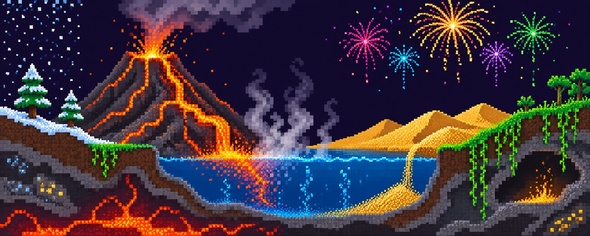
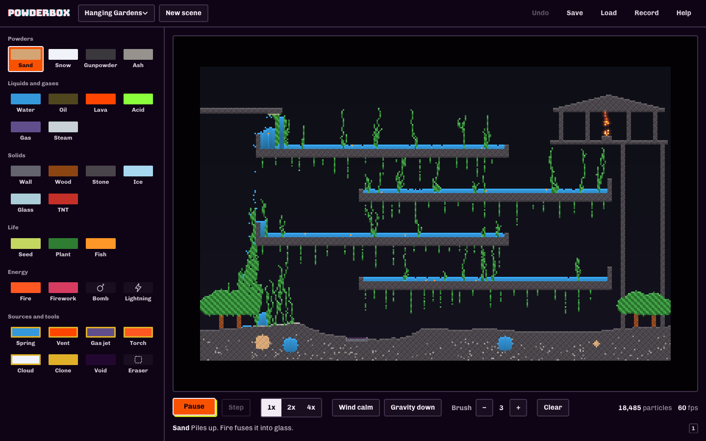
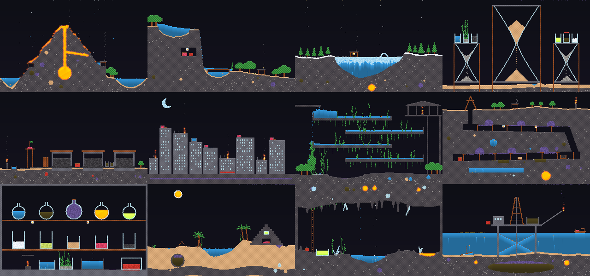

# PowderBox

A falling-sand physics sandbox that runs entirely in the browser. Pour, burn, freeze, grow and blow up 25 materials across 12 hand-built scenes. No install, no account, no runtime dependencies.



## Play

Play it now at [aieatassam.github.io/powder-box](https://aieatassam.github.io/powder-box/), or run it locally:

```bash
npm install
```

```bash
npm run dev
```

Open the printed URL, pick a material and draw on the screen. Works with mouse, pen and touch.

## Scenes

Every scene is generated from a seed, so "New scene" gives a fresh variation each time.



| Scene | What is going on |
| --- | --- |
| Volcano | The crater never stops welling up, a lava tube waits under one flank, and the cabins below are in the way. |
| Waterfall Canyon | A spring-fed lake spills over the cliff, and something is sealed inside the rock behind the falls. |
| Frozen Lake | Fish circle under thick ice while snow falls and something hot stirs below the lake bed. |
| Hourglass | Three glass timers are running under a shelf of jars. Crack one open or flip gravity. |
| Powder Keg | Carry a flame from the torch to the fuse, then stand well back from the TNT. |
| Fireworks Night | Half the rooftop wicks are already burning, the rest are yours to light, and a gas main runs under the street. |
| Hanging Gardens | Water steps down the terraces past fish and vines, under a temple whose fire never goes out. |
| Gas Mine | Gas has pooled under the gallery roofs, the timbers are dry, and someone left TNT at the bottom. |
| Alchemist's Lab | Every flask holds something different, so break the glass and mix them, cabinet of TNT included. |
| Desert Oasis | Palms drink at the pool, the pyramid hides a trap over its treasure, and the sun will crack. |
| Crystal Cave | A dripping cavern of ice and glass lit by a lava pool, with an old camp by the ladder. |
| Oil Rig | The drill has stopped just short of the reservoir, so finish the job and mind the flare. |

Most scenes also hide pockets of gas, oil or water in the ground. Dig, and you may find one.

## Materials

| Group | Materials |
| --- | --- |
| Powders | Sand, Snow, Gunpowder, Ash |
| Liquids and gases | Water, Oil, Lava, Acid, Gas, Steam (smoke is produced by burning) |
| Solids | Wall, Wood, Stone, Ice, Glass, TNT |
| Life | Seed, Plant, Fish |
| Energy | Fire, Firework, Bomb, Lightning |
| Sources | Spring (water), Vent (lava), Gas jet, Torch (fire), Cloud (snow): each pours its material forever |
| Tools | Clone (a source for whatever touches it first), Void (a drain), Eraser |

Some of the interactions worth trying:

- Fire fuses sand into glass, burns wood to ash and sets oil, gas, plants and seeds alight.
- Lava cools into stone in thin streams, boils water into steam and stays molten in a pool.
- Seeds that land near water sprout into plants, and plants drink the water they touch to grow taller. A seed that lands on ash roots into it with no water at all and grows about twice as tall, so a burnt forest can be replanted.
- Fish swim in any water, eat seeds that fall in and breed when fed. Out of water they flop about and die; heat cooks them.
- TNT blows a large hole when fire, lava or a spark reaches it, and one block sets off the next.
- Water freezes next to ice. Snow melts next to anything hot.
- Gunpowder flashes and sometimes explodes. Fireworks launch from the top of the stack and burst in colour.
- Acid eats almost everything except glass and wall.
- Liquids layer by density: oil floats on water, water on acid, everything on lava.
- Things accelerate as they fall. A stream of water that lands hard splashes wider than one poured gently.

## Controls

| Key | Action |
| --- | --- |
| `Space` | Pause or play |
| `.` | Step one tick while paused |
| `[` `]` or mouse wheel | Smaller or larger brush |
| `w` | Cycle wind |
| `g` | Flip gravity |
| `c` | Clear |
| `n` | New random scene |
| `←` `→` | Previous or next scene |
| `r` | Start or stop recording a video |
| `Ctrl`/`⌘` `z` | Undo |
| `Ctrl`/`⌘` `s` / `o` | Save or load a `.pbox` file |

Each material also has its own key, shown beside its description and in the Help dialog. Your work is saved in the browser automatically and restored on the next visit.

## Saving and recording

- **Save** downloads the whole screen as a `.pbox` file (128 KB: an 8-byte header, then one byte of material and one byte of state per cell). **Load**, or dropping the file on the page, restores it exactly. Files that are not a valid save are refused and leave the screen untouched.
- **Record** captures up to 30 seconds of video at 960×600 and downloads it as MP4 or WebM, whichever the browser can encode.
- The screen is also saved to browser storage every 10 seconds and restored on the next visit.
- Wind, gravity and speed are settings, not part of a save.

## How it works

```
index.html, src/style.css   interface (tokens in src/tokens.css)
src/main.ts                 input, canvas, undo, save/load, recording
src/worker/sim.worker.ts    thin message adapter around the engine
src/sim.ts                  the engine: a pure class with no DOM access
src/scenes.ts               seeded scene generators
src/types.ts                materials, tools, worker protocol, save format
```

- The world is a 320×200 grid of one-byte cells with a second byte of per-cell state (burn time, growth, colour) and a third for fall speed.
- The engine runs in a Web Worker. Each frame it steps the grid, renders straight into an RGBA buffer and transfers that buffer to the main thread, which only calls `putImageData`.
- Rows are scanned from the floor upward and the horizontal direction alternates each tick, so nothing drifts to one side. A per-cell stamp guarantees one move per tick.
- Cells that cannot change are skipped: walls and glass outright, and any cell whose four neighbours hold the same material. A full screen costs about half a millisecond per tick on a laptop.
- The screen is drawn at a whole number of device pixels per cell, so cells never have uneven widths.
- Liquids at rest stay at rest, and their shading comes from depth rather than per-cell noise, so pools do not shimmer.

## Development

```bash
npm test
```

Runs the engine and scene tests (vitest). The engine takes an injected random source, so tests are deterministic.

```bash
npm run build
```

Type-checks and builds to `dist/`. The GitHub Actions workflow tests, builds and deploys to GitHub Pages.

To render every scene to PNG without a browser (this is how the images above and the scene picker thumbnails are made):

```bash
SHOTS=docs/scenes TICKS=700 SCALE=3 npx vitest run tests/shots.test.ts
```

```bash
SHOTS=public/scenes TICKS=250 SCALE=1 npx vitest run tests/shots.test.ts
```
